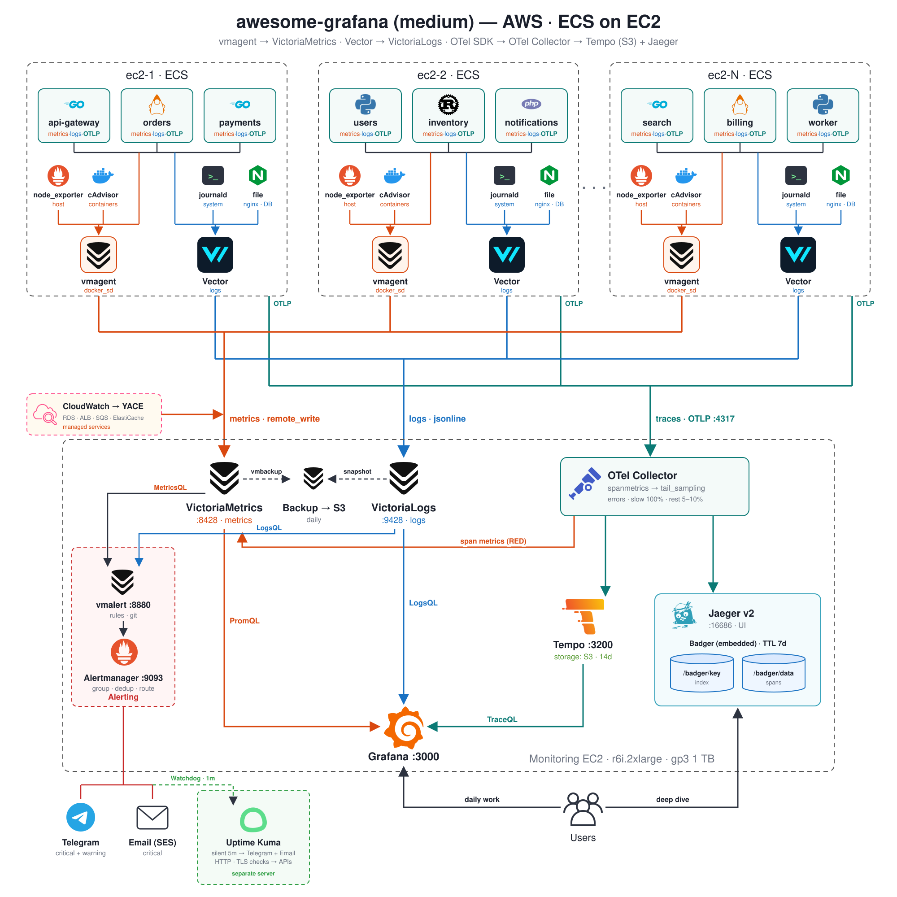
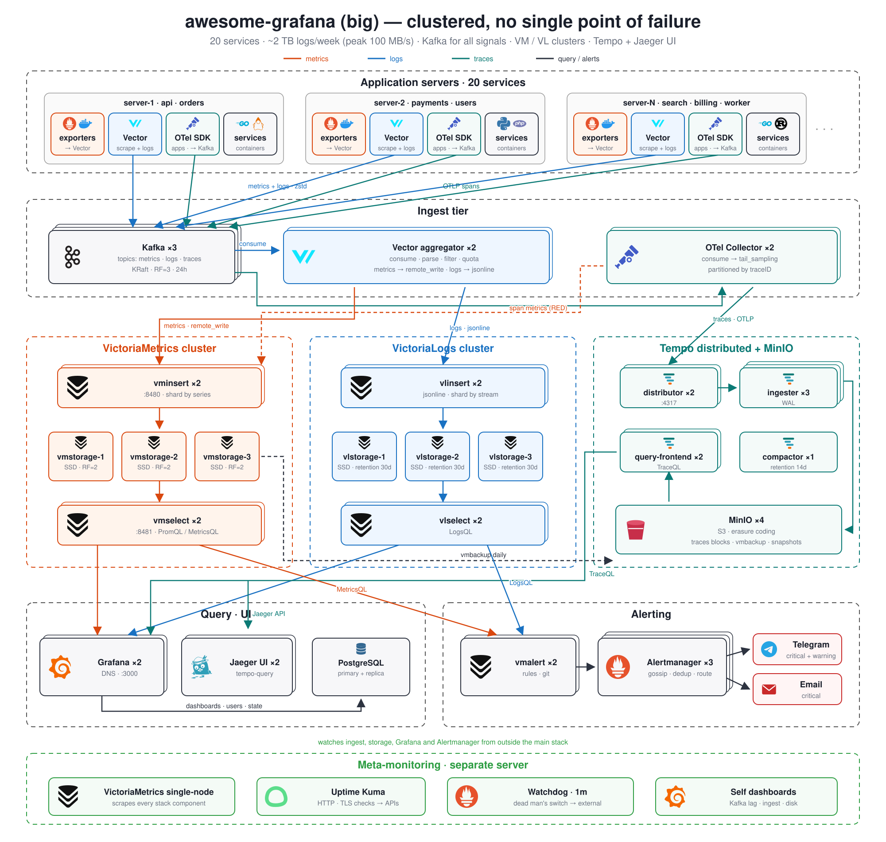

# awesome-grafana

Self-hosted observability stacks built around Grafana, in three sizes. Pick the one that matches how much
you run; each is a separate folder.

| Stack | For | Status |
|-------|-----|--------|
| [small](small/) | One Docker host: metrics, logs, traces, Telegram alerts and ready-made dashboards in one `docker compose up` | Ready |
| [medium](medium/docs/architecture.svg) | Several hosts / AWS ECS, terabytes of logs per week | In design |
| [big](big/docs/architecture.svg) | Large, multi-cluster setups | In design |

## small

Prometheus + VictoriaMetrics for metrics, Vector + VictoriaLogs for logs, Tempo for traces,
Alertmanager to Telegram. Start with the [small README](small/).

## medium (design)

## big (design)

